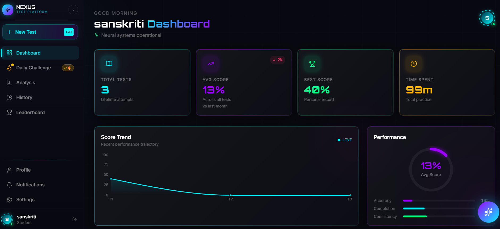
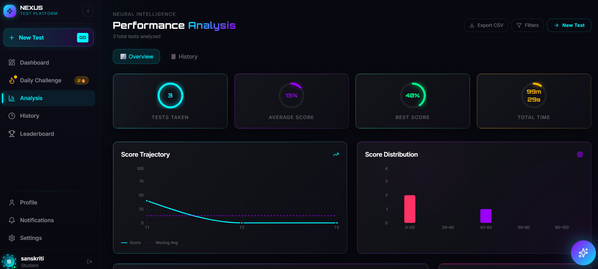
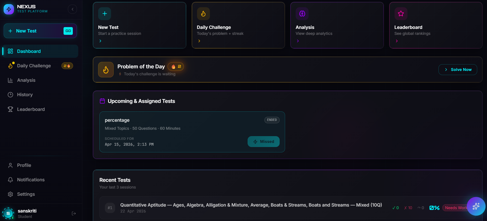
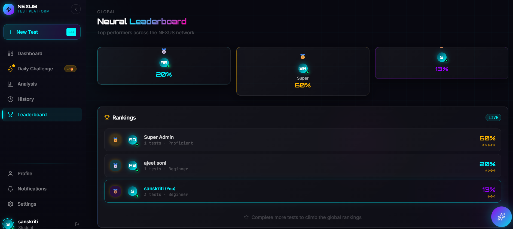
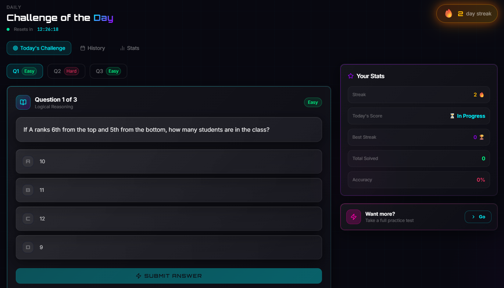
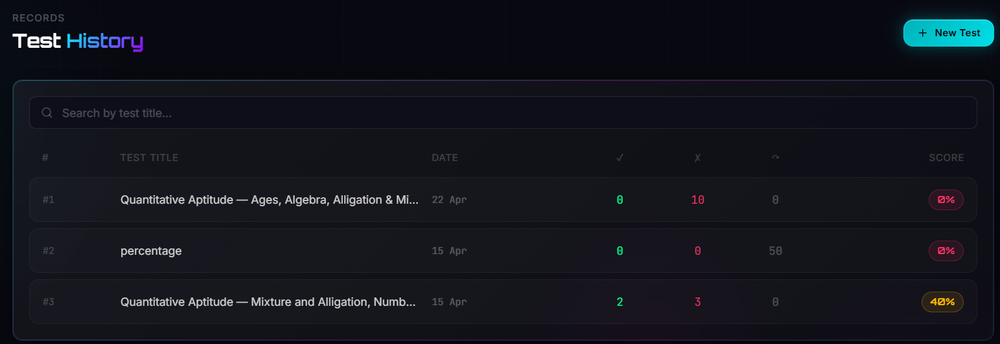

<div align="center">

# 🧠 Aptitude Test Platform

**Full-stack MERN platform for practising Quantitative Aptitude, Logical Reasoning and Verbal Ability with proctored tests, AI tutoring and detailed analytics.**

[](https://aptitude001.web.app)
[](https://aptitude001.web.app/demo)
[](https://aptitude-test-platform-i74k.onrender.com/health)


**👉 [Check out the live site here](https://aptitude001.web.app)**

</div>

---

## 🌐 Live Links

| | Link |
|---|---|
| **Website** | **https://aptitude001.web.app** |
| **Demo test (no signup)** | https://aptitude001.web.app/demo |
| **Backend health check** | https://aptitude-test-platform-i74k.onrender.com/health |

> ⏳ The backend runs on Render's free tier and sleeps after 15 minutes of inactivity.
> The first request can take **~50 seconds** while it wakes up. After that it is fast.

---

## 📸 Screenshots

| Dashboard | Performance Analysis |
|---|---|
|  |  |

| Full-Length Test | Leaderboard |
|---|---|
|  |  |

| Problem of the Day | Test History |
|---|---|
|  |  |

---

## ✨ Features

### 🎓 For Students
- **Custom practice tests**: pick a topic, subtopics, difficulty (Easy / Medium / Hard / Mixed), number of questions and time limit.
- **Scheduled and full-length mock tests** assigned by the admin, with in-app notifications.
- **Instant results** with score, accuracy, time taken and a topic-wise breakdown.
- **Solution review** for every question, with the correct answer and explanation.
- **Performance analysis** with charts for progress over time and strong / weak topics.
- **AI Study Assistant** (Google Gemini): ask doubts and get step-by-step solutions and tips based on your own weak areas.
- **Leaderboard**, **Problem of the Day**, **test history** and a **profile** with picture upload.
- **Demo test without signup** from the landing page.
- **Light and dark themes**.

### 🛡️ Proctored Test Environment
- **Camera check before the test** and **face detection** during it (flags when no face is visible).
- **Fullscreen enforcement** and **tab-switch detection**, recorded as violations.
- **Watermark** on the test screen to discourage screenshots and sharing.
- **Live Proctoring dashboard** for admins (Socket.IO) showing students who are taking a test and their violations in real time.

### 🧑‍💼 For Admins
- **Admin dashboard** with platform statistics.
- **Question bank**: add, edit and delete questions, with images for the question and for each option.
- **Bulk upload from Excel** with a preview before saving.
- **Scheduled and full-length tests** for selected sections and students.
- **User management**: change roles and remove accounts.
- **Student analytics** with a performance report for each student.
- **Platform analytics** and **admin settings**.

### 🔐 Accounts and Security
- JWT authentication with **email verification** and **forgot / reset password** emails.
- Passwords hashed with bcrypt; rate limiting on login, signup and password reset.
- Helmet security headers, a CORS allow-list and role-based access (student / admin).

---

## 🏗️ Tech Stack

| Layer | Technology |
|---|---|
| **Frontend** | React 19, TypeScript, Vite, Tailwind CSS, Framer Motion, Recharts, Zustand, React Router |
| **Backend** | Node.js, Express, TypeScript, Socket.IO, Mongoose |
| **Database** | MongoDB Atlas |
| **AI** | Google Gemini API |
| **Images** | Cloudinary (compressed to WebP with Sharp) |
| **Email** | Brevo API (Gmail SMTP for local development) |
| **Hosting** | Firebase Hosting (frontend), Render (backend) |

```
Browser ──► Firebase Hosting (React SPA)
   │
   └──► Render (Express API + Socket.IO) ──► MongoDB Atlas
                                        ├──► Cloudinary (images)
                                        ├──► Gemini (AI assistant)
                                        └──► Brevo (emails)
```

---

## 🚀 Run Locally

**Prerequisites:** Node.js 20+ and MongoDB (local or Atlas).

```bash
git clone https://github.com/Ajeetsoni2002/aptitude-test-platform.git
cd aptitude-test-platform

# Backend
cd backend
cp .env.example .env      # fill in MONGO_URI, JWT_SECRET, GEMINI_API_KEY, ...
npm install
npm run dev               # http://localhost:5000

# Frontend (in a new terminal)
cd frontend
npm install
npm run dev               # http://localhost:5173
```

The Vite dev server proxies `/api` to `localhost:5000`, so the frontend needs no `.env` locally.

---

## ☁️ Deployment

The app is deployed for free: the frontend on **Firebase Hosting** and the backend on **Render**.
See **[DEPLOYMENT.md](DEPLOYMENT.md)** for the step-by-step guide.

| Change | How it goes live |
|---|---|
| Backend code | Merge to `main`; Render deploys automatically |
| Frontend code | `cd frontend && npm run deploy` |

---

## 📄 License

[MIT](LICENSE) © 2026 Ajeet Kumar Soni
